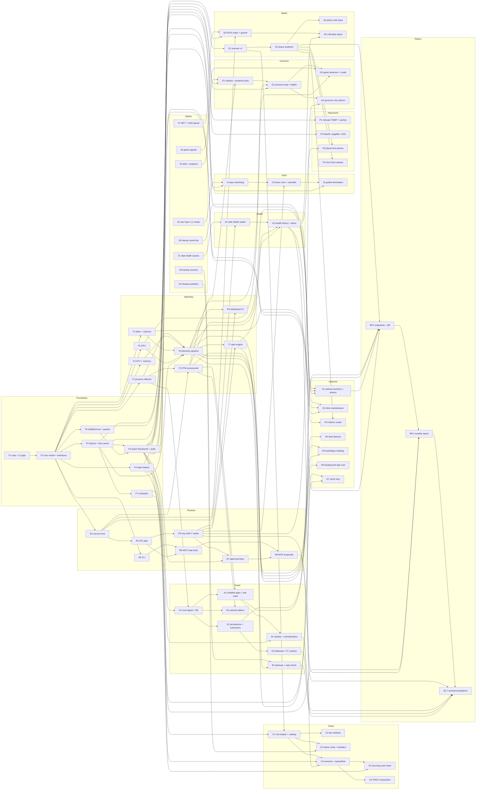

# MyClean — Work DAG

The dependency graph of every work package (WP) up to v1.0. An arrow
`A --> B` means B cannot start until A is done. Milestones are in
[roadmap.md](roadmap.md); requirement IDs are in [prd.md](prd.md); design is
in [architecture.md](architecture.md).

Sizes are relative effort: **S = 1, M = 2, L = 3** units.

## Graph



## Work packages

| WP | Name | Depends on | Size | Milestone | PRD |
|---|---|---|---|---|---|
| D1 | Dev deploy script `tools/deploy/deploy.ps1` (**done**) | — | S | M0 | NFR-OPS-2 |
| F1 | Repo, CMake/vcpkg, CI quality gate; presets + install layout per deploy contracts C1–C2 | — | S | M0 | NFR-QA-1 |
| F2 | Core model, platform interfaces, fakes | F1 | M | M0 | — |
| F3 | SQLite store, migrations, time-series downsampler | F2 | M | M0 | MON-9 |
| F4 | Rules / classes / KB loaders with schema validation | F2 | S | M0 | CLN-1, GOV-1 |
| F5 | `SafeRemove`, deny-list, reparse/cloud guards | F2 | M | M0 | NFR-SAFE-1 |
| F6 | Action framework, policy state machine, audit log | F3, F5 | M | M0 | NFR-SAFE-2/3 |
| F7 | In-app scheduler with catch-up | F3 | S | M0 | RPT-1 |
| X1–X8 | Spikes (see roadmap) | — | S each | before the WP that needs each one | — |
| R1 | Service host honoring deploy contracts C3, C4, C7 | F2 | S | M1 | NFR-REL-1 |
| R2 | IPC pipe, JSON-RPC, DACL | R1 | M | M1 | NFR-SEC-1 |
| R3 | Tray shell, toasts, badge; single instance + quit event (C5) | R2 | M | M1 | UI-1, RPT-2 |
| R4 | Dashboard (live charts, disk cards, volumes, top trees) | R3, T6 | L | M1 | UI-2 |
| R5 | CLI framework `--json`, including `status --json` (C6) | F2 | S | M1 | UI-5 |
| R6 | MCP server, read tools | R5, R2 | M | M1 | UI-6 |
| R7 | Approval inbox | R3, F6 | M | M2 | UI-4 |
| R8 | MCP proposal tools | R6, R7 | S | M2 | UI-6 |
| T1 | Process collector + trees | F2 | M | M1 | MON-5 |
| T2 | ETW process + network | T1, R1 | M | M1 | MON-6, MON-8 |
| T3 | CPU + memory collectors | F2 | S | M1 | MON-1, MON-2 |
| T4 | Physical-disk + volume collectors | F2 | S | M1 | MON-3, MON-4 |
| T5 | GPU collector | F2 | S | M1 | MON-7 |
| T6 | Telemetry pipeline: bus, downsampling, history queries | T1, T3, T4, T5, F3 | M | M1 | MON-9 |
| T7 | Alert engine | T6, R3 | M | M1 | RPT-2 |
| H1 | Disk-health reader (NVMe, SATA, USB fallback) | X1, R1 | M | M1 | HLT-1/2/3 |
| H2 | Health history, delta alerts, endurance projection | H1, T6, T7 | M | M1 | HLT-4/5/6 |
| I1 | Input watchdog + incident store | X2, F3 | M | M1 | INP-1/2 |
| I2 | Freeze view + mechanism classifier | I1, R3 | M | M1 | INP-3 |
| I3 | Guided elimination | I2, F6 | S | M4 | INP-4 |
| K1 | Trust signal + knowledge base v1 | F4, T1 | M | M1 | SEC-1 |
| S1 | Scanner v1 | F5 | M | M2 | SPC-1 |
| S2 | Top-N, old downloads, used installers, exact duplicates | S1 | M | M2 | SPC-1/4/5 |
| S3 | NTFS index ($MFT + USN), growth per folder | X7, R1, F3 | L | M4 | SPC-2/3 |
| S4 | Photo near-duplicates | S2 | S | M4 | SPC-4 |
| S5 | Cold-data report | S3, H2 | S | M4 | SPC-6 |
| C1 | Rule engine + catalog v1 | F4, S1 | M | M2 | CLN-1 |
| C2 | Developer-artifact scanner | C1 | M | M2 | CLN-2 |
| C3 | Native commands, Windows handlers, DISM | C1, X3 | M | M2 | CLN-3 |
| C4 | Cleaning executor: tiers, quarantine, restore | C1, F6, H2 | M | M2 | CLN-4/5, HLT-7 |
| C5 | Recurring `auto` cleaning | C4, F7 | S | M2 | CLN-4 |
| C6 | WSL/Docker VHDX report + compaction | C4 | S | M4 | CLN-6 |
| P1 | Relocate TEMP/TMP + package caches | F6 | M | M2 | PLC-1 |
| P2 | Hibernation, page file, shadow storage | F6 | S | M2 | PLC-2 |
| P3 | Placement advisor | H2, S2 | M | M4 | PLC-3 |
| P4 | Dev Drive advisor | S2 | S | M4 | PLC-4 |
| G1 | Process classes + proactive jobs | X4, T2, F4 | M | M3 | GOV-1/2 |
| G2 | Pressure loop, ladder, rollback, fail-open | G1, T6, F6 | L | M3 | GOV-3/4/5, NFR-REL-2 |
| G3 | Game detection + game mode | G2, X5, T5 | M | M3 | GOV-6 |
| G4 | Governor tray actions + pause | G2, R3 | S | M3 | GOV-8/9 |
| O1 | Startup inventory + disable/enable | X6, F6, T2 | M | M4 | OPT-1 |
| O2 | Drive maintenance (re-TRIM, defrag when idle) | H2, T4, F6 | S | M4 | OPT-2 |
| O3 | Search-indexer scope | S2, F6 | S | M4 | OPT-3 |
| O4 | Memory-leak detector | T6 | S | M4 | OPT-4 |
| O5 | Boot/logon tracking | T2, T6 | M | M4 | OPT-5 |
| O6 | Background-app cost report | T6 | S | M4 | OPT-6 |
| O7 | Verify loop (before/after, auto-undo) | F6, T6 | M | M4 | OPT-7 |
| E1 | Persistence points + browser extensions | K1 | M | M5 | SEC-2/3 |
| E2 | Background network talkers | K1, T2 | S | M5 | SEC-4 |
| E3 | Defender + opt-in VirusTotal verdicts | E1 | S | M5 | SEC-5 |
| A1 | Installed apps + last-used fusion | K1, T2 | M | M5 | APP-1 |
| A2 | App classification + uninstall plans | A1, F6 | S | M5 | APP-2 |
| B1 | Backup detection, repo check, age alert | X8, T7 | M | M5 | BAK-1/2/3 |
| RP1 | Snapshots + diff | S2, E1, A1, O1, H2 | M | M6 | RPT-3 |
| RP2 | Monthly report + delivery | RP1, F7, R3 | M | M6 | RPT-3 |
| Q1 | Seven-prompt acceptance suite | RP2, R8, A2, E3, B1 | M | M6 | §7 |

## Critical path

Earliest-finish analysis (S = 1, M = 2, L = 3, unlimited parallelism):

```
F1 → F2 → R1 → R2 → R3 → T7 → H2 → RP1 → RP2 → Q1      = 18 units
```

What this means:

- **The runtime spine (service → IPC → tray → alerts) is the bottleneck**,
  not the clever parts. R1–R3 should start the moment F2 lands.
- **H2 (disk-health history) gates cleaning (C4), placement (P3, S5) and drive
  maintenance (O2)**, because nothing may be moved onto or maintained on a
  drive whose health is unknown.
- The governor (G1 → G2 → G3 finishes at 14) has 4 units of slack. The
  spikes (X1–X8) have the most slack and should run first, in parallel.

## Parallel lanes

Disjoint work that can run at the same time (separate agents or sessions):

| Lane | Sequence |
|---|---|
| Spine | F1 → F2 → R1 → R2 → R3 → R7 → R8 |
| Data | F3 → F7 → T6 → T7 → H2 |
| Collectors | T1 → T2, T3, T4, T5 (all parallel after F2) |
| Safety & clean | F5 → S1 → C1 → C2 / C3 → C4 → C5 |
| Spikes | X1 … X8, all parallel from day 0 |
| Governor | G1 → G2 → G3 → G4 (after T2, T6) |
| Guard | K1 → E1 → E3, A1 → A2, B1 |
